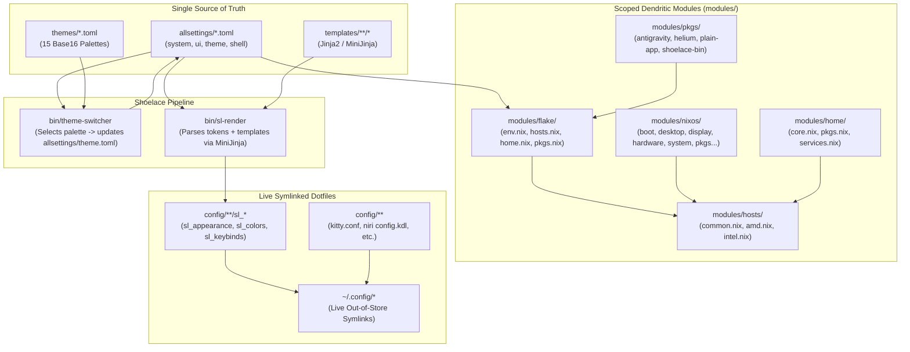

# 🏛️ Shoelace Architecture & System Design

This document describes the architectural layout, data pipelines, and design principles of the **Shoelace** NixOS & Home Manager configuration.

---

## 🌟 Core Philosophy

1. **Single Source of Truth (`allsettings/*.toml`)**:
   System attributes, UI metrics, hardware flags, and shell configurations are stored in human-readable, flat TOML files directly under `allsettings/`.
2. **Instant Live Dotfiles (`config/`)**:
   Instead of storing immutable dotfiles in the Nix store (which requires a multi-second `nixos-rebuild switch` or `home-manager switch` on every typo fix), dotfiles are symlinked live using `config.lib.file.mkOutOfStoreSymlink` into `~/.config/`.
3. **Template Engine (`templates/` + `bin/sl-render`)**:
   Dynamic dotfile configurations (such as theme color codes, keybindings, and font sizes) are compiled on demand using MiniJinja (`minijinja-cli`) into `config/**/sl_*`.
4. **Developer-Recommended Scoped Dendritic Architecture (`modules/`)**:
   Zero scattered `.nix` directories in the root, zero `_` prefix workarounds, and zero `default.nix` boilerplate. Modules are scoped cleanly into 2-level deep domains under `modules/`:
   - `modules/flake/`: Flake-parts modules auto-imported via `(inputs.import-tree ./modules/flake)`. Defines `env.nix`, `hosts.nix`, `home.nix`, and `pkgs.nix`.
   - `modules/nixos/`: Pure NixOS modules auto-imported via `(inputs.import-tree ./modules/nixos)`. Clean, flat feature modules without nested subfolders (`boot.nix`, `desktop.nix`, `display.nix`, `hardware.nix`, `kanata.nix`, `networking.nix`, `pkgs.nix`, `system.nix`, `theme.nix`, `virtualization.nix`).
   - `modules/home/`: Pure Home Manager modules auto-imported via `(inputs.import-tree ./modules/home)` (`core.nix`, `pkgs.nix`, `services.nix`).
   - `modules/hosts/`: Machine profiles (`common.nix`, `amd.nix` for user laptop, `intel.nix` for friend's laptop).
   - `modules/pkgs/`: Custom standalone derivations (`antigravity.nix`, `helium.nix`, `plain-app.nix`, `shoelace-bin.nix`).
5. **Zero Boilerplate & Native Options**:
   Zero `config.mySystem.*` dummy options. Modules configure standard NixOS options directly, driven by feature toggles in `allsettings/features.toml`.
6. **Pure Nix Modular Packages**:
   Package management is fully declarative and native Nix with 17 categorised package sets in `modules/home/pkgs.nix` and base system packages in `modules/nixos/pkgs.nix`.

---

## 🗺️ System Data Flow Diagram

---

## 📁 Repository Directory Taxonomy

| Directory      | Purpose                                                                                                               |
| :------------- | :-------------------------------------------------------------------------------------------------------------------- |
| `allsettings/` | Flat Single Source of Truth configuration tokens for system, UI, apps, and shell (`*.toml`).                          |
| `assets/`      | Wallpapers (`wallpaper.jpg`) and project screenshots (`screenshots/`).                                                |
| `bin/`         | Fast CLI utilities: `sl-render`, `theme-switcher`, `wallpaper`, `power-menu`.                                         |
| `config/`      | Application dotfiles symlinked directly to `~/.config/`. Contains static files and `sl_*` rendered files.             |
| `docs/`        | Architecture guides and technical documentation.                                                                      |
| `modules/`     | Clean 2-level scoped dendritic modules: `flake/`, `nixos/`, `home/`, `hosts/`, `pkgs/`. Zero `_`, zero `default.nix`. |
| `templates/`   | MiniJinja templates compiled into `config/**/sl_*`.                                                                   |
| `themes/`      | 15 pre-configured TOML color schemes compatible with Base16.                                                          |

---

## 📦 Custom Packages & Overlays (`modules/pkgs/`)

All custom derivations live inside `modules/pkgs/`:

- **`antigravity-cli`**: Standalone Linux binary wrapper for the Antigravity AI coding assistant CLI (`agy`).
- **`helium`**: Wrapped AppImage Chromium browser with Ozone Wayland flags and dark mode.
- **`plain-app`**: Hotspot gateway wrapper and desktop launcher for mobile sync.
- **`shoelace-bin`**: Derivation bundling all executable scripts from `bin/` into `$out/bin`.

These are exported via `modules/flake/pkgs.nix` through `flake.overlays.default` and `perSystem.packages`, ensuring they can be consumed cleanly across both NixOS (`environment.systemPackages`) and Home Manager (`home.packages`) as standard `pkgs.*` attributes.

---

## 🎨 Theming Lifecycle

1. User selects a theme (e.g. `just theme catppuccin-mocha` or interactively via Fuzzel).
2. `bin/theme-switcher`:
   - Reads `themes/catppuccin-mocha.toml`.
   - Writes color variables into `allsettings/theme.toml`.
   - Calls `bin/sl-render --theme` to re-render all `sl_colors.*` files in `config/`.
3. Live applications (such as Kitty, Niri, Wayle, Fuzzel) read the updated `sl_colors` file immediately, changing colors with zero restart latency.
4. On next `just switch` or `just home`, Stylix aligns GTK themes, icons, and cursor schemes.
